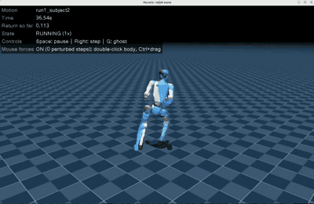
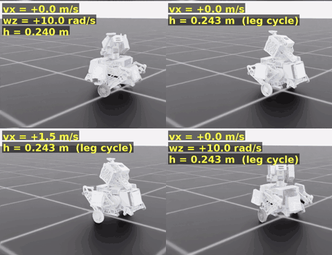
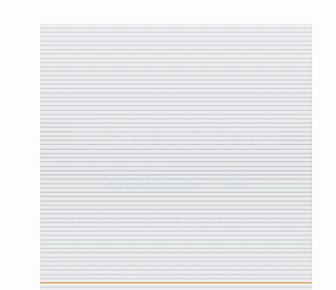

<div align="center">

# Awesome SuperMimic

[](https://github.com/sindresorhus/awesome) [](https://arxiv.org/abs/2610.28480) [](LICENSE) [](CONTRIBUTING.md)

**收集 SuperMimic 的社区实现、方法扩展、演示和学习资源。**

[English](README.md) · 简体中文

[原始论文](https://arxiv.org/abs/2610.28480) · [官方项目](https://supermimic.github.io/) · [交互演示](https://supermimic.github.io/demo/) · [社区项目](#社区项目)

</div>

<p align="center">
  <a href="https://supermimic.github.io/media/world-model/wm_on.mp4"></a><br>
  <b>世界模型预测</b>
</p>

<table>
  <tr>
    <td width="50%" align="center">
      <a href="https://supermimic.github.io/media/hero/hero_montage_desktop.mp4"></a><br>
      <b>仿真全身动作</b>
    </td>
    <td width="50%" align="center">
      <a href="https://supermimic.github.io/media/real/real_bay-wide.mp4"></a><br>
      <b>G1 真机演示</b>
    </td>
  </tr>
</table>

<p align="center"><sub>原作影像：<a href="https://supermimic.github.io/">SuperMimic 作者</a> · 点击预览观看原视频 · <a href="assets/official/README.md">素材来源</a></sub></p>

建议先了解原始工作，再按框架和任务选择实现。本仓库由社区维护，各收录项目的贡献归属于其作者。

## 目录

- [原始 SuperMimic](#原始-supermimic)
- [社区项目](#社区项目)
- [相关方法与基线](#相关方法与基线)
- [数据与学习资源](#数据与学习资源)
- [参与贡献](#参与贡献)
- [论文引用](#论文引用)
- [致谢与许可](#致谢与许可)
- [Star History](#star-history)

## 原始 SuperMimic

**[SuperMimic: Scaling Humanoid Whole-Body Control with One Differentiable World Model](https://arxiv.org/abs/2610.28480)**<br>
Qiayuan Liao、Yiyang Shao、Junfeng Long、Kevin Zakka、Roberto Horowitz、Pieter Abbeel、Koushil Sreenath。<br>
**UC Berkeley · CoRL 2026 Oral**

[论文](https://arxiv.org/abs/2610.28480) · [PDF](https://arxiv.org/pdf/2610.28480) · [项目主页](https://supermimic.github.io/) · [官方视频](https://supermimic.github.io/media/real/film-1080.mp4) · [浏览器演示](https://supermimic.github.io/demo/)

SuperMimic 从仿真状态转移中学习一个共享的可微世界模型，再通过短时想象轨迹训练动作跟踪策略。世界模型和策略在同一个循环中持续更新，策略梯度经过学习到的模型。[方法介绍](https://supermimic.github.io/#loop)。

<p align="center">
  <a href="https://arxiv.org/pdf/2610.28480v1#page=4">
    
  </a>
</p>
<p align="center">
  <sub>原论文 Figure 2 · <a href="https://arxiv.org/pdf/2610.28480v1#page=4">算法框架，第 4 页</a> · <a href="https://arxiv.org/pdf/2610.28480v1#page=15">完整伪代码 Algorithm A.1，第 15 页</a></sub>
</p>

世界模型使用 **8 步回放窗口**拟合，策略和 critic 通过 **32 步想象轨迹**学习。更新策略时，世界模型的权重固定，但梯度仍经过模型传回策略。图中蓝色虚线表示梯度，❄️ 表示该阶段权重冻结，🔥 表示该阶段权重参与训练。

作者报告：**单张 H100 训练 3 小时**超过 SONIC 已发布 checkpoint 的回报，**129,514 个动作中失败 25 个**；两张 H100 训练 9.8 小时后失败数为 0。这是训练动作覆盖结果，且两者训练硬件与数据规模不同。[原始结果与计算量口径](https://supermimic.github.io/#compute)。

**官方代码状态（2026-10-28 核查）：**官方主页提供论文、视频和浏览器演示，尚未链接训练代码仓库。下列条目均为社区实现或扩展。

## 社区项目

**39 个项目，按亮点选择。** ⭐ 推荐有实验记录、可复用工具或直观学习示例的项目；各分类内的项目及推荐项按仓库 Star 数降序排列（2026-10-30 快照，无法获取数量的放最后）；徽章独立更新。成绩和演示均为上游报告，本清单未独立重跑；各条目附核查版本。

下表精选 **18 个各有所长的项目**，每行先写推荐理由。已于 **2026-10-30** 重新核查 38 个可访问仓库的上游报告。资源与耗时对应所引运行，缺失值标为“未列出”；不同任务与评测协议不能直接排名，演示或权重不等于定量成绩。

| 项目 · Stars | 任务与训练配置 | 训练效果与亮点 |
| --- | --- | --- |
| **🚀 [真机部署（2）](#真机部署与-sim2real)** | | |
| **[SuperMimic-Repro-Sim2Real](#supermimic-repro-sim2real)** [](https://github.com/NJU-R-L-Group-Embodied-Lab/SuperMimic-Repro-Sim2Real/stargazers) | G1 · 真机舞蹈<br>mjlab / MuJoCo Warp；部署：MuJoCo + Unitree SDK<br>GPU / 耗时未列出 | **从单段动作微调走到 G1 真机**<br>约 22 秒单段舞蹈真机连续完成 2 次；有松弛保护绳。[来源](https://github.com/NJU-R-L-Group-Embodied-Lab/SuperMimic-Repro-Sim2Real/blob/f8f60d7bbdba68468c050ef100af02d752ca238e/README.md) |
| **🔬 [独立复现（5）](#独立复现)** | | |
| **[supermimic_vibed](#supermimic_vibed)** [](https://github.com/zita-ch/supermimic_vibed/stargazers) | G1 · LAFAN1 跟踪<br>Isaac Lab 3 / Newton + MuJoCo Warp<br>1× RTX PRO 6000 Blackwell · 1.47 h | **多个下游项目沿用的训练基线**<br>训练集 40 条：回报 0.829，失败 0/40。[来源](https://github.com/zita-ch/supermimic_vibed/blob/8bfc1158bd968f729fcc65d5e897a05b05ea3d36/README.md) |
| **[SuperMimic-Reproduced](#supermimic-reproduced)** [](https://github.com/CuboiLeo/SuperMimic-Reproduced/stargazers) | G1 · BONES-SEED 跟踪<br>mjlab / MuJoCo Warp<br>4× RTX 5090 · 7.1 h（约 28 GPU·h） | **全量 BONES-SEED 复现日志与权重**<br>129,943 条训练动作：回报 0.930，失败 495/129,943；论文观测。[来源](https://github.com/CuboiLeo/SuperMimic-Reproduced/blob/ba6105349069bf040f1fdad60873d13138d505a2/docs/EXPERIMENTS.md) |
| **[SuperMimic Mjlab](#supermimic-mjlab)** [](https://github.com/Breezewrf/supermimic_mjlab/stargazers) | G1 · LAFAN 跟踪<br>mjlab / MuJoCo Warp<br>1× RTX A6000 48 GB · 约 4 h / 15k 迭代 | **逐项消融、检查点与 23DoF G1 部署记录**<br>固定起点完整评测：40/40 成功，回报 0.8528；所选检查点。[来源](https://github.com/Breezewrf/supermimic_mjlab/blob/a7cee74636a4c596cd8710f8c2e51f82d78bb150/README.md) |
| **[supermimic_vibe](#supermimic_vibe)** [](https://github.com/dhmbb2/supermimic_vibe/stargazers) | G1 · BONES-SEED 跟踪<br>mjlab / MuJoCo Warp<br>1× RTX A6000 · 14.4 h | **逐项核对论文，公开消融与未复现项**<br>128,904 条全库评测：回报 0.923，失败 45 条；50% 环境无探索噪声采集。[来源](https://github.com/dhmbb2/supermimic_vibe/blob/d0934d069207ee745be8489d9631a8314c94c1f3/README.md) |
| **🧩 [方法改动（6）](#方法改动与形态适配)** | | |
| **[MorphMimic](#morphmimic)** [](https://github.com/lzyang2000/morphmimic/stargazers) | G1 / X2 Ultra / T2 · 跟踪、遥操作<br>mjlab / MuJoCo Warp<br>三本体全量配置：3× GPU，约 51–58 GB 显存/卡 · 60k 发布权重；耗时未列出 | **跨本体统一策略，人体输入直接遥操作**<br>统一 ONNX 策略与 PICO 人体接口；G1 真机已测试，X2 / T2 仅仿真；未列出统一成功率。[来源](https://github.com/lzyang2000/morphmimic/blob/770394b4a0cad9effbf807a6c03435d1699733d0/README.md) |
| **[InstantTrack](#instanttrack)** [](https://github.com/Huy-Quang-Dao/instantTrack/stargazers) | G1 · LAFAN1 跟踪<br>mjlab / MuJoCo Warp<br>1× RTX 5090 32 GB · 约 15 min；不含离线评测 | **面向短周转复现，三个种子核验达标**<br>3 个种子：40 条训练动作回报 ≥0.82 且失败 0/40，连续 3 个检查点达标。[来源](https://github.com/Huy-Quang-Dao/instantTrack/blob/a33691a08bca8802d9d2985f62e2567479735a8e/README.md) |
| **👁️ [感知与地形（4）](#感知地形与四足任务)** | | |
| **[InstinctMJ](#instinctmj--supermimic)** [](https://github.com/project-instinct/InstinctMJ/stargazers) | G1 · 感知式地形跟踪<br>mjlab + instinct_rl / MuJoCo Warp<br>1× RTX 3090 · 2.8 h / 8k 迭代 | **把可微深度渲染接入世界模型训练**<br>10 动作、5 地形：整段成功率 95%，完成度 97%；单种子，开启相机噪声。[来源](https://github.com/project-instinct/InstinctMJ/blob/3f0952d36268c6aad299e256d27cc65d3bcc1434/src/instinct_mj/rl/supermimic/README.md) |
| **[Go2-SuperMimic](#go2-supermimic)** [](https://github.com/Zhengtianjin/go2-supermimic/stargazers) | Go2 · 追逐、闪避、地形<br>mjlab / MuJoCo Warp<br>GPU / 耗时未列出 | **从人形跟踪扩展到四足追逐与闪避**<br>公开平地 / 障碍 / 地形 actor；困难地形仍会跌倒或碰杆。[来源](https://github.com/Zhengtianjin/go2-supermimic/blob/d9eee9b3f248e5300e636c433255db2c1c3e086a/README.md) |
| **🦾 [操作与灵巧手（4）](#操作与灵巧手)** | | |
| **[Dex SuperMimic](#dex-supermimic)** [](https://github.com/CumulusAlpha/Dex-Supermimic/stargazers) | Wuji Hand 1/2 · 方块重定向、转笔<br>mjlab / MuJoCo Warp<br>8k 迭代权重；GPU 型号 / 耗时未列出 | **Wuji 灵巧手多任务，公开任务权重**<br>3 个任务检查点与演示；未列出定量成功率。[来源](https://github.com/CumulusAlpha/Dex-Supermimic/blob/3a7c1a33fd8e5c6cc047e381ea9309da96553c27/README.md) |
| **[supermimic_manipulation](#supermimic-for-robot-manipulation)** [](https://github.com/emoPointer/supermimic_manipulation/stargazers) | ARX5 · Lemon / BoxInBin / MugHang<br>mjlab / MuJoCo Warp<br>1× A100 80 GB（共卡） · 依次 1.8 / 1.9 / 2.8 h | **机械臂操作，保留初态评测与重置状态库**<br>各 256 个保留初态回合：成功率依次 100% / 94.9% / 96.9%。[来源](https://github.com/emoPointer/supermimic_manipulation/blob/810e5768c50117d2fec75f20f9e643a11cd0882b/README.md) |
| **[In-Hand Rotation mjlab](#in-hand-rotation-mjlab)** [](https://github.com/Msornerrrr/in-hand-rotation-mjlab/stargazers) | LEAP Hand · 方块偏航旋转<br>mjlab / MuJoCo Warp<br>1× RTX 4090 · 25 min（世界模型）；6.5 h（PPO） | **同一手内任务的世界模型 / PPO 对照**<br>仿真达到 PPO 约 0.26 奖励/秒水平；每配置单次运行，真机演示为 PPO。[来源](https://github.com/Msornerrrr/in-hand-rotation-mjlab/blob/0ab03eb2244b4a1a020d94ef38a4823bb9e15ba0/README.md) |
| **💪 [肌肉与交互（3）](#肌肉驱动交互与诊断)** | | |
| **[muscle-supermimic](#muscle-supermimic)** [](https://github.com/kaibohex/muscle-supermimic/stargazers) | MS-Human-700 / MyoFullBody · 肌肉动作跟踪<br>mjlab / MuJoCo Warp<br>1× RTX 5090 · 依次 10.1 / 6.0 h | **两种肌肉驱动本体，检验未见动作**<br>108 条保留 KIT 动作：回报 0.91 / 0.83，完成 104/108 / 101/108。[来源](https://github.com/kaibohex/muscle-supermimic/blob/932ac22ca720b1c4db40c4323a3b67bf3c1eaa99/README.md) |
| **🛠️ [框架与训练栈（6）](#框架与训练栈)** | | |
| **[UniSuperMimic](#unisupermimic)** [](https://github.com/Motphys/Uni-SuperMimic/stargazers) | G1 · BONES-SEED 跟踪<br>UniLab / mjwarp（该成绩所用后端）<br>1× RTX 4090（上游标注 48 GB） · 8k 迭代；该优化运行耗时未列出 | **全库评测，量化 EMA 与训练循环优化**<br>129,487 条全库：回报 0.9395，失败 193 条；EMA + no-sync；12k 基线为 1.69 h / 350 次失败。[来源](https://github.com/Motphys/Uni-SuperMimic/blob/05a9772ca09509c50a4cc3fe96f9d6b3c180f3d2/README.md) |
| **[ScaleBFM_Plus](#scalebfm_plus--supermimic)** [](https://github.com/Hxxxz0/ScaleBFM_Plus/stargazers) | G1 · 大规模动作跟踪<br>IsaacLab + RSL-RL / Isaac Sim<br>16× RTX 5090 · 8.3 h | **Transformer 策略与大规模留出动作评测**<br>训练 13.8 万条 / 309 h 动作；2,575 条留出动作成功率 99.5%。[来源](https://github.com/Hxxxz0/ScaleBFM_Plus/blob/65e4d524bd31fdc4284ba8c6e624fb0b0127da03/ScaleTrack/README.md) |
| **🤖 [本体移植（6）](#机器人移植与重定向)** | | |
| **[SuperMimic-MuJoCo](#supermimic-mujoco)** [](https://github.com/panhainan2020/SuperMimic-MuJoCo/stargazers) | G1 · LAFAN / 100STYLE 跟踪<br>mjlab / MuJoCo Warp；支持 CPU MuJoCo 评测<br>98k 迭代；GPU 型号 / 耗时未列出 | **固定策略的分布外评测与轨迹误差分析**<br>未微调的 3,573 条 100STYLE：回报 0.8045，完成 3,569 条；平均仅 18.77 s/条。[来源](https://github.com/panhainan2020/SuperMimic-MuJoCo/blob/db045afa9c52458f213e2c66037387e9c109a03a/results/098000/REPORT.md) |
| **[SuperMimic Retargeted](#supermimic-retargeted)** [](https://github.com/tianshuwu/supermimic-retargeted/stargazers) | G1 / A3 / X2 Ultra · 重定向、跟踪<br>mjlab / MuJoCo Warp + SOMA 重定向<br>GPU / 耗时未列出 | **多本体重定向与坐标一致性工具**<br>历史 LAFAN 基线失败分别为 0/40、0/40、2/40；额外锚点观测，无真机验证。[来源](https://github.com/tianshuwu/supermimic-retargeted/blob/ff69a0e5305126eb5b80b323bcd815805bc3df4e/README.md) |
| **💡 [直观学习（3）](#方法借鉴与探索)** | | |
| **[FlatWorld](#flatworld--supermimic-2d)** [](https://github.com/swaggyliu/FlatWorld/stargazers) | 2D 八关节人形 · 多技能跟踪<br>FlatWorld 2D 仿真<br>GPU / 耗时未列出 | **用 2D 多技能演示理解训练闭环**<br>约 33 秒多技能演示；程序化参考动作，非真实 LAFAN1 数据。[来源](https://github.com/swaggyliu/FlatWorld/blob/601d96c3aa69b5b226533f767d1c2e6f917c5a5d/supermimic2d/README.md) |

## 真机部署与 Sim2Real

真机运行栈与 Sim2Real 迁移路径。

<a name="supermimic-repro-sim2real"></a>

<a name="-supermimic-repro-sim2real"></a>

### ⭐ SuperMimic-Repro-Sim2Real [](https://github.com/NJU-R-L-Group-Embodied-Lab/SuperMimic-Repro-Sim2Real/stargazers)

[仓库](https://github.com/NJU-R-L-Group-Embodied-Lab/SuperMimic-Repro-Sim2Real) · [快速开始](https://github.com/NJU-R-L-Group-Embodied-Lab/SuperMimic-Repro-Sim2Real/blob/f8f60d7bbdba68468c050ef100af02d752ca238e/README.md#快速开始) · [v1.1 真机记录](https://github.com/NJU-R-L-Group-Embodied-Lab/SuperMimic-Repro-Sim2Real/blob/f8f60d7bbdba68468c050ef100af02d752ca238e/docs/REAL_ROBOT_LEAN35KFS.md) · [G1 部署](https://github.com/NJU-R-L-Group-Embodied-Lab/SuperMimic-Repro-Sim2Real/blob/f8f60d7bbdba68468c050ef100af02d752ca238e/docs/DEPLOY_G1.md)

- **团队：NJU R&amp;L Group Embodied Lab。** 在 CuboiLeo 的 mjlab 复现上增加自定义舞蹈、视频动作工具、单段动作微调、ONNX 导出，以及原生 MuJoCo 和 Unitree SDK 的 G1 部署流程。
- **上游报告：** v1.0 公开一段由四个动作片段组成、约 **46 秒的 G1 真机舞蹈**。v1.1 的单段策略 `e24_0355000` 在真机上**连续两次完成约 22 秒舞蹈**，包含两次快速转体和一次单脚落地的跳跃；此前 9 个模型都未能完成该动作。两次运行均挂着松弛的保护绳，同一模型重复运行不构成消融实验。
- **选择时注意：** v1.1 检查点只针对这一段舞蹈微调，不是通用动作跟踪模型；按论文观测训练与增加锚点观测仍是不同配置。 [核查版本](https://github.com/NJU-R-L-Group-Embodied-Lab/SuperMimic-Repro-Sim2Real/blob/f8f60d7bbdba68468c050ef100af02d752ca238e/README.md)。

<a href="https://github.com/NJU-R-L-Group-Embodied-Lab/SuperMimic-Repro-Sim2Real/releases/download/v1.1/shanshenbu_pro_real_robot.mp4"></a><br><sub>G1 真机 · v1.1 单段舞蹈；左为人类参考，右为机器人</sub>

<br>

<a name="supermimic-g1-deployment"></a>

### SuperMimic G1 Deployment [](https://github.com/KyrieYoung926/supermimic_deploy/stargazers)

[仓库](https://github.com/KyrieYoung926/supermimic_deploy) · [MuJoCo 使用](https://github.com/KyrieYoung926/supermimic_deploy/blob/7e63e3bbd5150d55afbdece28278781800f3ed21/README.md#3-run-in-mujoco) · [真机使用](https://github.com/KyrieYoung926/supermimic_deploy/blob/7e63e3bbd5150d55afbdece28278781800f3ed21/README.md#4-run-on-the-real-g1)

- **作者：KyrieYoung926。** 面向 29 自由度 G1 部署 SuperMimic-Reproduced 策略，采用 ONNX Runtime、MuJoCo 和 Unitree SDK2。
- **提供内容：** 提供仿真与 G1 真机演示，并分别说明如何准备部署资产、在仿真和真机上运行策略。
- **选择时注意：** 仓库重点是部署，不是新的训练基准；动作数据、模型权重和机器人资产保留各自条款，不由代码许可证统一覆盖。 [核查版本](https://github.com/KyrieYoung926/supermimic_deploy/blob/7e63e3bbd5150d55afbdece28278781800f3ed21/README.md)。

<a href="https://github.com/KyrieYoung926/supermimic_deploy"></a><br><sub>G1 真机 · 上游部署演示</sub>

<br>

## 独立复现

从原方法复现入手，查看训练、评估和复现记录。

<a name="supermimic_vibed"></a>

<a name="-supermimic_vibed"></a>

### ⭐ supermimic_vibed [](https://github.com/zita-ch/supermimic_vibed/stargazers)

[仓库](https://github.com/zita-ch/supermimic_vibed) · [安装与使用](https://github.com/zita-ch/supermimic_vibed/blob/8bfc1158bd968f729fcc65d5e897a05b05ea3d36/README.md#setup) · [结果](https://github.com/zita-ch/supermimic_vibed/blob/8bfc1158bd968f729fcc65d5e897a05b05ea3d36/README.md#result-lafan1-40-clips-one-rtx-pro-6000-blackwell)

- **作者：Chong Zhang。** 基于 Isaac Lab 3 独立实现 G1 动作跟踪，提供 kit-less 环境、训练、完整动作评估和渲染工具。
- **上游报告：** 单张 RTX PRO 6000 Blackwell 训练 **1.47 小时**，40 条 LAFAN1 动作的归一化回报为 **0.829**，**0 / 40 失败**。
- **选择时注意：** 作者将其描述为快速开发、未经充分审查的复现；与论文的差异包括关闭自碰撞、MLP 使用 bf16，以及额外输入参考根部相对朝向。 [核查版本](https://github.com/zita-ch/supermimic_vibed/blob/8bfc1158bd968f729fcc65d5e897a05b05ea3d36/README.md)。

<a href="https://github.com/zita-ch/supermimic_vibed"></a><br><sub>仿真 · LAFAN1 动作集锦</sub>

<br>

<a name="supermimic-reproduced"></a>

<a name="-supermimic-reproduced"></a>

### ⭐ SuperMimic-Reproduced [](https://github.com/CuboiLeo/SuperMimic-Reproduced/stargazers)

[仓库](https://github.com/CuboiLeo/SuperMimic-Reproduced) · [环境与安装](https://github.com/CuboiLeo/SuperMimic-Reproduced/blob/ba6105349069bf040f1fdad60873d13138d505a2/README.md#setup) · [实验日志](https://github.com/CuboiLeo/SuperMimic-Reproduced/blob/ba6105349069bf040f1fdad60873d13138d505a2/docs/EXPERIMENTS.md) · [检查点](https://github.com/CuboiLeo/SuperMimic-Reproduced/releases/tag/e8-boneseed-100k)

- **作者：CuboiLeo。** 基于 mjlab 从零实现 G1 跟踪，提供中文复现记录、LAFAN1/BONES-SEED 数据处理、多卡训练、交互回放和全量数据检查点。
- **上游报告：** 按论文观测在 **129,943 条 BONES-SEED 动作**上训练，4 张 RTX 5090 运行 **7.1 小时（约 28 GPU·h）**。实验日志报告该动作库上**回报 0.930、495 / 129,943 失败**；按名称排除 452 条后，过滤评测集上为**回报 0.932、145 / 129,491 失败（0.11%）**。在 LAFAN1 上，锚点相对观测达到 **0.904、3 / 40 失败**；三次论文观测运行则为 **0.56–0.59、3–9 / 40 失败**。
- **选择时注意：** BONES-SEED 片段较短（中位 5.8 秒），而论文观测策略在 100–300 秒的 LAFAN1 整段动作上会漂移；两种观测口径不能直接比较。上游 README 将 0.930 与过滤后的失败数并列；上述分集合数据采用[实验日志](https://github.com/CuboiLeo/SuperMimic-Reproduced/blob/ba6105349069bf040f1fdad60873d13138d505a2/docs/EXPERIMENTS.md)。 [核查版本](https://github.com/CuboiLeo/SuperMimic-Reproduced/blob/ba6105349069bf040f1fdad60873d13138d505a2/README.md)。

<a href="https://github.com/CuboiLeo/SuperMimic-Reproduced/releases/tag/e8-boneseed-100k"></a><br><sub>仿真 · 同一个 BONES-SEED 全量策略完成六段高难度动作</sub>

<br>

<a name="supermimic-mjlab"></a>

<a name="-supermimic-mjlab"></a>

### ⭐ SuperMimic Mjlab [](https://github.com/Breezewrf/supermimic_mjlab/stargazers)

[仓库](https://github.com/Breezewrf/supermimic_mjlab) · [安装](https://github.com/Breezewrf/supermimic_mjlab/blob/a7cee74636a4c596cd8710f8c2e51f82d78bb150/doc/setup_en.md) · [消融实验与检查点](https://github.com/Breezewrf/supermimic_mjlab/blob/a7cee74636a4c596cd8710f8c2e51f82d78bb150/README.md#ablation-results-and-released-checkpoint)

- **作者：Breezewrf。** 基于 mjlab 为 Unitree G1 独立复现 SuperMimic，提供完整的性能提升消融实验、多动作与速度训练、OOD 动作回放、video2motion、完整动作评估，以及已发布的策略与世界模型检查点。
- **上游报告：** 所选检查点在全部 40 条 LAFAN 动作的固定起点、完整片段确定性评估中，达到 **40 / 40 成功、平均完成率 100%、归一化回报 0.8528**。使用 **单张 RTX A6000 48 GB**、4,096 个环境和 FP32 网络，训练 **15,000 次迭代约需 4 小时**。
- **性能提升消融：** 完整记录从 Actor/Critic 输入归一化，依次加入躯干坐标系下的动作朝向锚点、世界模型归一化及修正余弦学习率调度的提升过程：在全部 40 条动作、15,000 次迭代的评估中，归一化回报均值为 **0.6016 → 0.8130 → 0.8504 → 0.8526**。最终重复运行均值与上述所选检查点分数分别报告。 新版文档新增 RoboJuDo-Plus 的 SuperMimic 部署入口；作者报告使用 G1 **23DoF** 真机，速度跟踪仍在开发。 [核查版本](https://github.com/Breezewrf/supermimic_mjlab/blob/a7cee74636a4c596cd8710f8c2e51f82d78bb150/README.md)。

<a href="https://github.com/Breezewrf/supermimic_mjlab/blob/77183062eb92026bfbee2daf276f87cad36fd957/doc/assets/demo_v0.gif"></a><br><sub>仿真 · 60.8 秒动作回放中的 12 秒片段；点击查看上游完整 GIF</sub>

<br>

<a name="supermimic_vibe"></a>

### ⭐ supermimic_vibe [](https://github.com/dhmbb2/supermimic_vibe/stargazers)

[仓库](https://github.com/dhmbb2/supermimic_vibe) · [安装](https://github.com/dhmbb2/supermimic_vibe/blob/d0934d069207ee745be8489d9631a8314c94c1f3/README.md#setup) · [结果记录](https://github.com/dhmbb2/supermimic_vibe/blob/d0934d069207ee745be8489d9631a8314c94c1f3/notes/RESULTS.md)

- **作者：dhmbb2。** 在 mjlab / MuJoCo Warp 中独立复现 G1 跟踪，并逐项记录 PPO-Sim/PPO-WM、critic、想象时域、推力恢复、速度控制、BONES-SEED 扩容及 SONIC 对照。
- **上游报告：** 单张 RTX A6000 上，LAFAN1 在 **1.34 小时**达到回报 **0.833**，最佳检查点为 **11.4 小时、0.947、0 / 40 失败**。在 **128,904 条 BONES-SEED** 上，让半数环境无探索噪声采集的改动配置，在 **14.4 小时**达到 **0.923、45 / 128,904 失败**；耗时均不含评测。
- **选择时注意：** 无噪声采集比例是论文之外的改动。贴近论文的 BONES-SEED 运行在约 6 小时后崩溃，双卡“零失败”未复现；这些负结果与消融一并公开。A6000 与论文 H100 耗时不作等价比较，未覆盖真机迁移。 [核查版本](https://github.com/dhmbb2/supermimic_vibe/blob/d0934d069207ee745be8489d9631a8314c94c1f3/README.md)。

<a href="https://github.com/dhmbb2/supermimic_vibe/blob/072f0910dadc9d95c720e625b546120e9ce917c9/README.md"></a><br><sub>历史报告截图 · 较早的 A6000 实验；最新结果见上文</sub>

<br>

<a name="supermimic-on-rtx-5080"></a>

### SuperMimic on RTX 5080 [](https://github.com/rzc156/supermimic-rtx5080/stargazers)

[仓库](https://github.com/rzc156/supermimic-rtx5080) · [复现分析](https://github.com/rzc156/supermimic-rtx5080/blob/df967c61c29a2ed9ba6b188e1607ba59225fe8a7/REPRODUCTION_ANALYSIS.md) · [评测视频](https://github.com/rzc156/supermimic-rtx5080/blob/df967c61c29a2ed9ba6b188e1607ba59225fe8a7/results/lafan1_anchor/videos/index.html)

- **作者：rzc156。** 基于 CuboiLeo 的独立 mjlab 复现，面向单张 **16 GB RTX 5080**，使用 2,048 个训练环境和额外锚点相对观测。
- **上游报告：** **40k** 检查点训练 **2.7 小时**后达到 **0.8515 平均回报 / 0.8608 步加权回报**，**2 / 40 失败**；48k 检查点训练 **3.3 小时**，三次评测均值为 **0.8375**，**4–6 / 40 失败**。
- **选择时注意：** 只有单个训练 seed，且额外锚点观测使其不等价于论文观测口径。作者以 40k 为重点检查点，但 40k/44k/48k 的差异仍需多 seed 验证。 [核查版本](https://github.com/rzc156/supermimic-rtx5080/blob/df967c61c29a2ed9ba6b188e1607ba59225fe8a7/README.md)。

<a href="https://github.com/rzc156/supermimic-rtx5080/blob/df967c61c29a2ed9ba6b188e1607ba59225fe8a7/results/lafan1_anchor/videos/index.html"></a><br><sub>仿真 · 40k 检查点在 15 秒 LAFAN1 行走片段上的回放；点击查看全部七段视频</sub>

<br>

## 方法改动与形态适配

关注算法改动、多本体形态适配和专项控制研究。

<a name="morphmimic"></a>

<a name="-morphmimic"></a>

### ⭐ MorphMimic [](https://github.com/lzyang2000/morphmimic/stargazers)

[仓库](https://github.com/lzyang2000/morphmimic) · [安装](https://github.com/lzyang2000/morphmimic/blob/770394b4a0cad9effbf807a6c03435d1699733d0/README.md#setup) · [方法差异](https://github.com/lzyang2000/morphmimic/blob/770394b4a0cad9effbf807a6c03435d1699733d0/README.md#differences-from-supermimic)

- **作者：Lizhi Yang 等。** 在 mjlab / MuJoCo Warp 中让 G1、X2 Ultra、T2 共享世界模型、策略或两者。v0.1 增加 24 关节 / 五点人体接口，将 PICO 人体跟踪直接输入策略，无需先重定向为机器人动作。
- **上游报告：** 发布 **60,000 次迭代**的统一 ONNX 策略，覆盖 `g1_amber`、X2 Ultra、T2 及动作 / 人体两类接口；作者已在自有 **G1 真机**测试，提供机器人机载遥操作流程。X2 Ultra 和 T2 目前仅在仿真运行，未公布统一成功率或训练耗时。
- **选择时注意：** 发布策略使用针对自有 G1 弱腰电机的 `g1_amber` 配置，不能视作所有 G1 的通用验证。后续 78k 起检查点在真机站立摇晃，训练指标未暴露该问题。默认接口不需机器人世界位姿；可选 robot-anchor 模式仍需位姿估计。 [核查版本](https://github.com/lzyang2000/morphmimic/blob/770394b4a0cad9effbf807a6c03435d1699733d0/README.md)。

<a href="https://lzyang2000.github.io/morphmimic/static/videos/dance_hiphop_shuffle_sequence_v_001_R_003__A306.mp4"></a><br><sub>仿真 · G1 / X2 Ultra / T2 共享策略</sub>

[演示视频](https://lzyang2000.github.io/morphmimic/static/videos/morphmimic.mp4) · [交互演示](https://lzyang2000.github.io/morphmimic/demo/)

<br>

<a name="instanttrack"></a>

<a name="-instanttrack"></a>

### ⭐ InstantTrack [](https://github.com/Huy-Quang-Dao/instantTrack/stargazers)

[仓库](https://github.com/Huy-Quang-Dao/instantTrack) · [安装](https://github.com/Huy-Quang-Dao/instantTrack/blob/a33691a08bca8802d9d2985f62e2567479735a8e/README.md#setup) · [结果与消融](https://github.com/Huy-Quang-Dao/instantTrack/blob/a33691a08bca8802d9d2985f62e2567479735a8e/results/report.md) · [训练预设](https://github.com/Huy-Quang-Dao/instantTrack/blob/a33691a08bca8802d9d2985f62e2567479735a8e/scripts/presets.sh)

- **作者：Huy-Quang-Dao。** 基于 supermimic_vibed 的 mjlab 移植版实现 G1 跟踪，结合 GPU 训练循环优化、EMA 策略权重平均、更小的世界模型和失败重点采样；主预设还在想象轨迹中加入接触奖励。
- **上游报告：** 单张 RTX 5090 上，三个种子均在约 **15 分钟**达到 **LAFAN1 回报 ≥ 0.82、0 / 40 失败**，该时间点平均回报 **0.831**。报告的 **2.2 倍**加速相对于作者同机运行的 SuperMimic + EMA 基线，**6 倍**则相对于其未加 EMA 的基础复现。
- **选择时注意：** 时间取连续三个达标检查点中的首个，不含离线评估，也不是从环境安装开始的总耗时。评估覆盖仿真中的训练动作，尚无更大动作库或真机结果；模型大小、更新次数和训练奖励均有改动，不能据此作跨项目速度排名。 [核查版本](https://github.com/Huy-Quang-Dao/instantTrack/blob/a33691a08bca8802d9d2985f62e2567479735a8e/README.md)。

<a href="https://github.com/Huy-Quang-Dao/instantTrack/blob/a33691a08bca8802d9d2985f62e2567479735a8e/media/equal_time_15min.gif"></a><br><sub>上游仿真演示 · 相同的 15 分钟训练预算；左为 SuperMimic + EMA，右为 InstantTrack，展示倒地起身动作</sub>

<br>

<a name="allmimic"></a>

### allmimic [](https://github.com/Shimingyi/allmimic/stargazers)

[仓库](https://github.com/Shimingyi/allmimic) · [安装](https://github.com/Shimingyi/allmimic/blob/cb334ff674b2f57248f33f8c21b7fb526fbdf8cc/README.md#install) · [结果](https://github.com/Shimingyi/allmimic/blob/cb334ff674b2f57248f33f8c21b7fb526fbdf8cc/README.md#results)

- **作者：Shimingyi。** 基于 supermimic_vibe，在 mjlab 中混用上身残差动作与腿部绝对动作，并加入世界模型损失加权和动作均衡采样。
- **上游报告：** 单张 RTX 4090 使用推荐配置，训练 **0.83 小时**后，LAFAN1 完整动作评测达到 **0 / 40 失败、回报 0.91**；耗时不含评估。
- **选择时注意：** 推荐配置包含算法和数据采样改动；仅训练 306 条困难动作的实验，与完整 BONES-SEED 训练是不同实验。 [核查版本](https://github.com/Shimingyi/allmimic/blob/cb334ff674b2f57248f33f8c21b7fb526fbdf8cc/README.md)。

<a href="https://github.com/Shimingyi/allmimic"></a><br><sub>仿真 · 高难度动作片段</sub>

<br>

<a name="rethinking-supermimic"></a>

### Rethinking SuperMimic [](https://github.com/btx0424/rethinking-supermimic/stargazers)

[仓库](https://github.com/btx0424/rethinking-supermimic) · [安装](https://github.com/btx0424/rethinking-supermimic/blob/2cbbd1278bfb8bd59c31fe48d7413c46ae205e32/README.md#installation) · [实现对照](https://github.com/btx0424/rethinking-supermimic/blob/2cbbd1278bfb8bd59c31fe48d7413c46ae205e32/README.md#ours-the-paper-and-supermimic_vibed)

- **作者：btx0424。** 在 mjlab 的 G1 跟踪任务中研究目标条件化：比较目标与本体观测直接拼接，以及用 FiLM 调制策略各层。最新版本加入 HL-Gauss critic、梯度检查，以及可选朝向坐标系或骨盆坐标系的世界模型坐标。
- **选择时注意：** 提供可配置观测、锚点选择及 Viser 回放；实现对照表解释了与论文、supermimic_vibed 在自碰撞、观测输入等方面的差异。 [核查版本](https://github.com/btx0424/rethinking-supermimic/blob/2cbbd1278bfb8bd59c31fe48d7413c46ae205e32/README.md)。

<a href="https://github.com/btx0424/rethinking-supermimic/blob/ecdaeb6a916a16cf7eb69b19226c17be31a6bc27/README.md"></a><br><sub>历史实现对照表节选 · 2026-10-26 快照；当前对照见上方链接</sub>

<br>

<a name="standing-mbrl-vs-ppo"></a>

### Standing MBRL vs PPO [](https://github.com/JackMin7/supermimic_whole_body_tracking/stargazers)

[仓库](https://github.com/JackMin7/supermimic_whole_body_tracking) · [实验说明](https://github.com/JackMin7/supermimic_whole_body_tracking/blob/553a7d32dc5fc00cbe6de5ee46479af2fcceeda8/docs/EXPERIMENTS.md) · [复现说明](https://github.com/JackMin7/supermimic_whole_body_tracking/blob/553a7d32dc5fc00cbe6de5ee46479af2fcceeda8/docs/REPRODUCIBILITY.md)

- **作者：JackMin7。** 将 SuperMimic 的可微世界模型训练回路用于 G1 静态站立任务，并与基于 BeyondMimic 的 RSL-RL PPO 基线比较。
- **上游报告：** 在相同 29 自由度 G1、任务、奖励，以及约 1 小时、256 个环境的训练下，MBRL 在 **20 秒和 60 秒**测试中均 **32 / 32** 成功；PPO 分别为 **12 / 32** 和 **16 / 32**。20 秒平均关节 RMSE 为 **0.144 vs 0.415 rad**。
- **选择时注意：** 只有单个训练 seed，且共用 GPU、没有扰动；32 次 rollout 是同一策略的副本，不是独立 seed。作者未声称训练速度或真机收益。 [核查版本](https://github.com/JackMin7/supermimic_whole_body_tracking/blob/553a7d32dc5fc00cbe6de5ee46479af2fcceeda8/README.md)。

<a href="https://github.com/JackMin7/supermimic_whole_body_tracking/blob/553a7d32dc5fc00cbe6de5ee46479af2fcceeda8/media/ppo_vs_mbrl_60s.mp4"></a><br><sub>仿真 · 60 秒 PPO / MBRL 原速对照；PPO 终止后画面冻结</sub>

<br>

<a name="supermimic-on-locomujoco"></a>

### SuperMimic on LocoMuJoCo [](https://github.com/Alchedata/supermimic-locomujoco/stargazers)

[仓库](https://github.com/Alchedata/supermimic-locomujoco) · [安装](https://github.com/Alchedata/supermimic-locomujoco/blob/de9f39191b9e8b87ff1afd2b0129dd93d4795e8c/README.md#setup) · [结果](https://github.com/Alchedata/supermimic-locomujoco/blob/de9f39191b9e8b87ff1afd2b0129dd93d4795e8c/README.md#results)

- **团队：Alchedata。** 用 JAX 与 LocoMuJoCo 将方法移植到 H1，在 MLP、残差专家、动作敏感度和可信度相关的世界模型变体之外，新增**全状态 ODE 世界模型**和**抗饱和正则化**。
- **上游报告：** 固定 5,000 次迭代检查点、160 个初始状态时，在 Euler ODE 模型上增加抗饱和正则化，在三个 seed 上把总失败数从 **15 / 480 降到 1 / 480**。种子 43 从 **878.71 / 15 次失败**提升到 **935.38 / 0 次**，种子 42 则略有变差，因此并非所有 seed 都提高分数。
- **选择时注意：** 指标是 LocoMuJoCo 回合回报，与 G1 归一化跟踪分数不同；中点 ODE 加速实验仍在进行，未作为已完成结果计入。 [核查版本](https://github.com/Alchedata/supermimic-locomujoco/blob/de9f39191b9e8b87ff1afd2b0129dd93d4795e8c/README.md)。

<a href="https://github.com/Alchedata/supermimic-locomujoco/blob/de9f39191b9e8b87ff1afd2b0129dd93d4795e8c/docs/figures/return_vs_step.png"></a><br><sub>上游训练曲线 · ODE 与抗饱和变体，固定 5k 评估检查点</sub>

<br>

## 感知、地形与四足任务

视觉、高度扫描、地形与四足任务适配。

<a name="instinctmj--supermimic"></a>

<a name="-instinctmj--supermimic"></a>

### ⭐ InstinctMJ · SuperMimic [](https://github.com/project-instinct/InstinctMJ/stargazers)

[仓库](https://github.com/project-instinct/InstinctMJ/tree/supermimic) · [方法与结果](https://github.com/project-instinct/InstinctMJ/blob/3f0952d36268c6aad299e256d27cc65d3bcc1434/src/instinct_mj/rl/supermimic/README.md#results) · [发布资源](https://github.com/project-instinct/InstinctMJ/releases)

- **团队：Project Instinct。** 在 mjlab / instinct_rl 中实现 G1 感知式地形跟踪。当前世界模型预测机器人状态，再从已知场景与机器人网格进行**可微深度渲染**；策略梯度穿过渲染器与深度编码器，不再预测视觉潜变量。
- **上游报告：** 单张 RTX 3090、1,024 环境，训练 **8,000 次迭代 / 2.8 小时**后，在 **10 动作、5 地形**上整段成功率 **95%**、平均完成度 **97%**；单种子，每动作 12–13 回合，开启相机噪声，耗时不含评测。
- **选择时注意：** 使用 **supermimic 分支**。旧视觉潜变量方案的 **97% 成功率 / 3.2 小时**属于历史实现，不能与当前成绩混用。渲染使用已知场景网格，不等于真实未知环境感知；遵循 CC BY-NC 4.0 许可。 [核查版本](https://github.com/project-instinct/InstinctMJ/blob/3f0952d36268c6aad299e256d27cc65d3bcc1434/src/instinct_mj/rl/supermimic/README.md)。

<a href="https://github.com/project-instinct/InstinctMJ/blob/3f0952d36268c6aad299e256d27cc65d3bcc1434/src/instinct_mj/rl/supermimic/assets/method.png"></a><br><sub>方法图 · 预测状态与可微深度渲染</sub>

<br>

<a name="go2-supermimic"></a>

<a name="-go2-supermimic"></a>

### ⭐ Go2-SuperMimic [](https://github.com/Zhengtianjin/go2-supermimic/stargazers)

[仓库](https://github.com/Zhengtianjin/go2-supermimic) · [快速开始](https://github.com/Zhengtianjin/go2-supermimic/blob/d9eee9b3f248e5300e636c433255db2c1c3e086a/README.md#-quickstart) · [预训练策略](https://github.com/Zhengtianjin/go2-supermimic/blob/d9eee9b3f248e5300e636c433255db2c1c3e086a/README.md#pretrained-policies)

- **作者：Zhengtianjin。** 在 mjlab 中将方法用于 Unitree Go2 追逐与闪避，覆盖平地、障碍和地形场景，接入激光或高度扫描输入。
- **提供内容：** 公开平地、障碍、地形三类 actor，以及评估与录制工具；仅下载 actor 可以回放，恢复训练还需要世界模型与 critic。
- **选择时注意：** 目前只有仿真验证，目标感知来自仿真真值；发布的地形策略在最难设置下仍会摔倒或撞杆。 [核查版本](https://github.com/Zhengtianjin/go2-supermimic/blob/d9eee9b3f248e5300e636c433255db2c1c3e086a/README.md)。

<a href="https://github.com/Zhengtianjin/go2-supermimic"></a><br><sub>仿真 · Go2 地形追逐与闪避</sub>

<br>

<a name="supermimic-parkour"></a>

### SuperMimic Parkour [](https://github.com/yhx1203/supermimic_parkour/stargazers)

[仓库](https://github.com/yhx1203/supermimic_parkour) · [数据配置](https://github.com/yhx1203/supermimic_parkour/blob/f398519453a25b3f10722626b7356266d8b7f875/README.md#motion-data) · [检查点](https://github.com/yhx1203/supermimic_parkour/blob/f398519453a25b3f10722626b7356266d8b7f875/logs/php_five_skills/last.pt)

- **作者：yhx1203。** 基于 mjlab 和 PHP Parkour 动作匹配数据，用共享可微世界模型与 BPTT 策略学习实现五项技能的 G1 跑酷适配。
- **上游报告：** 在单张 GPU 上训练 **4 小时出头**，策略可跨越 **130 cm 障碍**；项目发布对应检查点并提供浏览器回放。
- **选择时注意：** PHP 动作包未随仓库分发，需要另行提供。这是上游单项演示与训练耗时报告，不是与 PPO 或 SuperMimic 的独立基准比较。 [核查版本](https://github.com/yhx1203/supermimic_parkour/blob/f398519453a25b3f10722626b7356266d8b7f875/README.md)。

<a href="https://github.com/yhx1203/supermimic_parkour/blob/f398519453a25b3f10722626b7356266d8b7f875/doc/%E5%BD%95%E5%B1%8F%202026%E5%B9%B410%E6%9C%8826%E6%97%A5%2016%E6%97%B641%E5%88%8626%E7%A7%92.gif"></a><br><sub>仿真 · 五项技能 PHP 跑酷策略，11.5 秒上游演示</sub>

<br>

<a name="supermimic-perceptive"></a>

### SuperMimic-perceptive [](https://github.com/mode1223345/SuperMimic-perceptive/stargazers)

[仓库](https://github.com/mode1223345/SuperMimic-perceptive) · [方法](https://github.com/mode1223345/SuperMimic-perceptive/blob/3d38bacbaf5bee7e782bdada6a6da678264d0bfa/Ae.md) · [进展记录](https://github.com/mode1223345/SuperMimic-perceptive/blob/3d38bacbaf5bee7e782bdada6a6da678264d0bfa/Progress.md)

- **作者：mode1223345。** 基于 Isaac Lab 3 的 supermimic_vibed，先预训练高程图自编码器，再冻结同一个编码器，供 actor、critic 和世界模型共享。
- **提供内容：** 记录平地／台阶地形上的四组控制对照，并单独提供重建检查；已发布的控制对照仍处于进行中。
- **选择时注意：** 当前使用仿真真值地图，尚未接入真实深度重建与真机感知；继承的基线成绩不能证明共享编码器带来控制收益。 [核查版本](https://github.com/mode1223345/SuperMimic-perceptive/blob/3d38bacbaf5bee7e782bdada6a6da678264d0bfa/README.md)。

<a href="https://github.com/mode1223345/SuperMimic-perceptive/blob/3d38bacbaf5bee7e782bdada6a6da678264d0bfa/results/Curves.png"></a><br><sub>训练曲线 · 2026-10-24 快照，控制对照实验仍在进行</sub>

<br>

## 操作与灵巧手

机械臂、手部与物体交互任务，灵巧手项目集中在此；探索性的 Ref2Dex 接触控制项目列在[方法借鉴与探索](#方法借鉴与探索)。

<a name="dex-supermimic"></a>

<a name="-dex-supermimic"></a>

### ⭐ Dex SuperMimic [](https://github.com/CumulusAlpha/Dex-Supermimic/stargazers)

[仓库](https://github.com/CumulusAlpha/Dex-Supermimic) · [安装](https://github.com/CumulusAlpha/Dex-Supermimic/blob/3a7c1a33fd8e5c6cc047e381ea9309da96553c27/README.md#installation) · [演示](https://github.com/CumulusAlpha/Dex-Supermimic/blob/3a7c1a33fd8e5c6cc047e381ea9309da96553c27/README.md#demos) · [检查点](https://github.com/CumulusAlpha/Dex-Supermimic/releases/tag/pretrained-wuji-v2)

- **作者：CumulusAlpha。** 将基于世界模型的策略训练用于 Wuji Hand 1/Hand 2 手内方块重定向，以及 Wuji Hand 2 旋转笔，采用 mjlab / MuJoCo Warp 和 InstinctMJ 任务框架。
- **提供内容：** 三套任务配置、随包的手部与方块资产、Viser 回放，以及 `pretrained-wuji-v2` Release 中的三个 8,000 次迭代检查点。
- **选择时注意：** 这是灵巧操作任务的适配，任务和奖励与人形动作跟踪不同。 [核查版本](https://github.com/CumulusAlpha/Dex-Supermimic/blob/3a7c1a33fd8e5c6cc047e381ea9309da96553c27/README.md)。

<table>
  <tr>
    <td width="50%" align="center"><a href="https://github.com/CumulusAlpha/Dex-Supermimic/blob/3a7c1a33fd8e5c6cc047e381ea9309da96553c27/docs/demos/hand1_reorient.gif"></a><br><sub>Wuji Hand 1 · 手内方块重定向</sub></td>
    <td width="50%" align="center"><a href="https://github.com/CumulusAlpha/Dex-Supermimic/blob/3a7c1a33fd8e5c6cc047e381ea9309da96553c27/docs/demos/hand2_pen_spin.gif"></a><br><sub>Wuji Hand 2 · 旋转笔</sub></td>
  </tr>
</table>

<br>

<a name="supermimic-for-robot-manipulation"></a>

<a name="-supermimic-for-robot-manipulation"></a>

### ⭐ SuperMimic for Robot Manipulation [](https://github.com/emoPointer/supermimic_manipulation/stargazers)

[仓库](https://github.com/emoPointer/supermimic_manipulation) · [安装](https://github.com/emoPointer/supermimic_manipulation/blob/810e5768c50117d2fec75f20f9e643a11cd0882b/README.md#install) · [结果](https://github.com/emoPointer/supermimic_manipulation/blob/810e5768c50117d2fec75f20f9e643a11cd0882b/README.md#results)

- **作者：Zhiqiang Zhou（emoPointer）。** 在 mjlab / MuJoCo Warp 中把 SuperMimic 迁移到仿真 ARX5 机械臂的基于状态操作任务，包括 Lemon、BoxInBin 和 MugHang。
- **上游报告：** 各任务使用第 4,000 轮检查点，在独立测试 reset bank 上完成 256 个完整回合，Lemon、BoxInBin、MugHang 成功率分别为 **100.0%、94.9%、96.9%**；单张 A100 80 GB 共卡训练耗时 **1.8 / 1.9 / 2.8 小时**。
- **选择时注意：** 使用 OmniReset 式重置类别缩短有效时域，想象阶段以可微几何代理替换接触成功判据；策略只输入低维状态。检查点与 reset bank 已在 Hugging Face 发布。 [核查版本](https://github.com/emoPointer/supermimic_manipulation/blob/810e5768c50117d2fec75f20f9e643a11cd0882b/README.md)。

<a href="https://github.com/emoPointer/supermimic_manipulation"></a><br><sub>仿真 · ARX5 Lemon 任务 · 两个保留初态回放</sub>

<br>

<a name="in-hand-rotation-mjlab"></a>

<a name="-in-hand-rotation-mjlab"></a>

### ⭐ In-Hand Rotation mjlab [](https://github.com/Msornerrrr/in-hand-rotation-mjlab/stargazers)

[仓库](https://github.com/Msornerrrr/in-hand-rotation-mjlab) · [安装](https://github.com/Msornerrrr/in-hand-rotation-mjlab/blob/0ab03eb2244b4a1a020d94ef38a4823bb9e15ba0/README.md#install) · [结果](https://github.com/Msornerrrr/in-hand-rotation-mjlab/blob/0ab03eb2244b4a1a020d94ef38a4823bb9e15ba0/README.md#results) · [检查点](https://github.com/Msornerrrr/in-hand-rotation-mjlab/blob/0ab03eb2244b4a1a020d94ef38a4823bb9e15ba0/README.md#quick-start-the-released-policies)

- **作者：Msornerrrr。** 在 mjlab / MuJoCo Warp 中将 SuperMimic 式世界模型策略学习（在线重拟合的 MLP 世界模型、通过想象轨迹反向传播、TD(λ) 评论家与权重平均）用于 LEAP 灵巧手，并在相同环境上提供 PPO 基线：掌心向上的方块偏航旋转、SO(3) 方块重定向（仅 PPO）和掌心向下用指尖旋转 22 种物体；使用在真实手上辨识的舵机模型。两种方法的检查点均已发布。
- **上游报告：** 方块偏航任务中，世界模型策略在 **25 分钟、1,800 万环境步**时达到 PPO 的水平（每秒奖励约 0.26），PPO 需 6.5 小时、2.62 亿步，最终为 **0.292 对 0.261**。掌心向下指尖旋转任务中（每个物体 64 回合、每回合 60 秒，指垫摩擦随机化 0.25–1.2），仅用关节信息的世界模型策略计分偏航达到 **933°**、掉落 **4.0%**，而由教师蒸馏并已部署的 PPO 学生为 **675° / 10.4%**，特权 PPO 教师为 **944° / 2.1%**。
- **选择时注意：** 世界模型结果均在仿真中；真实机器人视频（偏航与 SO(3)）展示的是 PPO 策略。指尖任务数值采用仓库自带评测（旋转奖励速度上限 0.3 rad/s，物体偏移 30 mm 记为掉落）。每种配置单次运行；训练时间基于单张 RTX 4090。 [核查版本](https://github.com/Msornerrrr/in-hand-rotation-mjlab/blob/0ab03eb2244b4a1a020d94ef38a4823bb9e15ba0/README.md)。

<a href="https://github.com/Msornerrrr/in-hand-rotation-mjlab"></a><br><sub>仿真 · 掌心向下指尖旋转，仅用关节信息的世界模型策略</sub>

<br>

<a name="humanoid-mimic--supermimic"></a>

### Humanoid Mimic · SuperMimic [](https://github.com/shuayyy/humanoid-amp-ppo/stargazers)

[仓库](https://github.com/shuayyy/humanoid-amp-ppo) · [快速开始](https://github.com/shuayyy/humanoid-amp-ppo/blob/681874bab20273ba9211cb92d5ff108900ce3490/README.md#quickstart) · [结果与协议](https://github.com/shuayyy/humanoid-amp-ppo/blob/681874bab20273ba9211cb92d5ff108900ce3490/docs/supermimic/RESULTS.md)

- **作者：shuayyy。** 在 mjlab 的同一组 G1 行走、下蹲和搬箱任务上对照 SuperMimic 与 PPO-Sim，仓库另含独立的 AMP-PPO 路线。
- **上游报告：** 两个 SuperMimic 种子在 **3,100 万环境步**时，64 回合随机评测的搬箱成功率达到 **100%**；成功条件是结束时箱子高度距参考值不超过 10 cm。
- **选择时注意：** 上述 SuperMimic 分数使用无噪声观测；新版评估已加入观测噪声，公开检查点尚未按这一设置重评。 [核查版本](https://github.com/shuayyy/humanoid-amp-ppo/blob/681874bab20273ba9211cb92d5ff108900ce3490/README.md)。

<a href="https://github.com/shuayyy/humanoid-amp-ppo/blob/4889389118e0c88d3945dff54d2cd3f992ed815e/assets/supermimic_vs_ppo_lift.mp4"></a><br><sub>搬箱 · SuperMimic 12k / PPO-Sim 6k 次迭代</sub>

<br>

## 肌肉驱动、交互与诊断

肌肉驱动本体、物理交互与接触诊断。

<a name="muscle-supermimic"></a>

<a name="-muscle-supermimic"></a>

### ⭐ Muscle SuperMimic [](https://github.com/kaibohex/muscle-supermimic/stargazers)

[仓库](https://github.com/kaibohex/muscle-supermimic) · [安装](https://github.com/kaibohex/muscle-supermimic/blob/932ac22ca720b1c4db40c4323a3b67bf3c1eaa99/README.md#install) · [当前状态](https://github.com/kaibohex/muscle-supermimic/blob/932ac22ca720b1c4db40c4323a3b67bf3c1eaa99/README.md#status)

- **作者：Kaibo He（kaibohex）。** 在 mjlab / MuJoCo Warp 中将 SuperMimic 扩展到肌肉驱动全身动作跟踪，支持 MS-Human-700（700 块肌肉）和 MyoFullBody（354 块肌肉）。
- **上游报告：** 使用 4,096 个环境、单张 RTX 5090，在 MuscleMimic 的 108 条 KIT 保留动作上，MS-Human-700 训练 **10.1 小时**达到归一化回报 **0.91**（第 16k 轮，**104 / 108** 完成）；MyoFullBody 训练 **6.0 小时**达到 **0.83**（第 10k 轮，**101 / 108** 完成）。
- **选择时注意：** 项目仍在持续更新；策略以 100 Hz 控制每块肌肉的激励，提供可微 torch 肌肉模型和重定向工具。KIT 数据需接受许可，AMASS 数据与重定向结果不得再分发；MS-Human-700 以 Git 子模块提供。 [核查版本](https://github.com/kaibohex/muscle-supermimic/blob/932ac22ca720b1c4db40c4323a3b67bf3c1eaa99/README.md)。

<a href="https://github.com/kaibohex/muscle-supermimic"></a><br><sub>仿真 · MS-Human-700 与 MyoFullBody · 第 10000 轮</sub>

<br>

<a name="supermimic-backflip-diagnostics"></a>

### SuperMimic Backflip Diagnostics [](https://github.com/liudi159/supermimic-backflip-5090/stargazers)

[仓库](https://github.com/liudi159/supermimic-backflip-5090) · [结果](https://github.com/liudi159/supermimic-backflip-5090/blob/5b313d75e804cdd2ff1ce9bdcfa899a98eca856b/README.md#结果) · [快速入口](https://github.com/liudi159/supermimic-backflip-5090/blob/5b313d75e804cdd2ff1ce9bdcfa899a98eca856b/README.md#快速入口)

- **作者：liudi159。** 使用 Isaac Lab 3 和单张 RTX 5090 专项研究 G1 后空翻，记录双腿对称性、接触力、穿透和落地稳定性。
- **上游报告：** 最终 V14 检查点完成后翻与落地保持，但原始严格评测记录到 1 帧非脚部穿透，**仍未通过验收**。
- **选择时注意：** 独立重评的临界接触结果出现变化，两次记录均保留；演示不能据此表述为稳健成功或论文全部实验复现。 [核查版本](https://github.com/liudi159/supermimic-backflip-5090/blob/5b313d75e804cdd2ff1ce9bdcfa899a98eca856b/README.md)。

<a href="https://github.com/liudi159/supermimic-backflip-5090/blob/5b313d75e804cdd2ff1ce9bdcfa899a98eca856b/media/v14_blue_checker.mp4"></a><br><sub>仿真 · 最终 V14 策略；严格评估未通过</sub>

<br>

<a name="supermimic-pera"></a>

### SuperMimic-PERA [](https://github.com/shangchaohu718/supermimic-pera/stargazers)

[仓库](https://github.com/shangchaohu718/supermimic-pera) · [当前状态](https://github.com/shangchaohu718/supermimic-pera/blob/0e89e55187a800341e609129b5d5200a607a467c/README.md#当前状态) · [滑板实验](https://github.com/shangchaohu718/supermimic-pera/blob/0e89e55187a800341e609129b5d5200a607a467c/docs/FIRST_SKATEBOARD_SKILL.md)

- **作者：shangchaohu718。** 基于 UniSuperMimic 开展 G1 交互实验，在 UniLab / MuJoCo 中冻结原跟踪器，再开发独立交互策略。
- **上游报告：** 独立滑板策略从 1 个标准初态和 8 个保留扰动初态出发，均完成 30 秒仿真滑行，前进 **39.87–42.13 m**。
- **选择时注意：** 跟踪与滑板仍需显式选择不同分支，尚未形成共享世界模型驱动的通用交互 actor；报告中的搬箱和楼梯原型尚未达到成功条件。 [核查版本](https://github.com/shangchaohu718/supermimic-pera/blob/0e89e55187a800341e609129b5d5200a607a467c/README.md)。

<a href="https://github.com/shangchaohu718/supermimic-pera/blob/0e89e55187a800341e609129b5d5200a607a467c/README.md"></a><br><sub>报告截图 · 跟踪检查点 500–6000，与滑板实验分开</sub>

<br>

## 框架与训练栈

可复用的训练、评估流程及与既有框架的集成。

<a name="holomotion--supermimic"></a>

### HoloMotion · SuperMimic [](https://github.com/HorizonRobotics/HoloMotion/stargazers)

[仓库](https://github.com/HorizonRobotics/HoloMotion) · [训练指南](https://github.com/HorizonRobotics/HoloMotion/blob/f52dd81ae935a828b0296f5ee0f833beb7378bf0/docs/supermimic.md) · [结果](https://github.com/HorizonRobotics/HoloMotion/blob/f52dd81ae935a828b0296f5ee0f833beb7378bf0/docs/supermimic.md#7-recorded-30-minute-results)

- **团队：Horizon Robotics。** 将 SuperMimic 接入 HoloMotion 的 G1 资产、HDF5 动作数据和 Hydra 流程，在 MuJoCo Warp 与 Isaac PhysX 上共用 PPO 的任务和评测接口。
- **上游报告：** 选定的 MuJoCo Warp 配置在单张 RTX 5090 上训练 **30 分钟**后，完整通过 **32 / 40 条 LAFAN1 训练动作**。
- **选择时注意：** 已验证路线使用紧凑策略；预览来自另一轮运行的短片段，不能替代完整动作评测，也不代表规划中的大策略集成已经验证。 [核查版本](https://github.com/HorizonRobotics/HoloMotion/blob/f52dd81ae935a828b0296f5ee0f833beb7378bf0/docs/supermimic.md)。

<a href="https://github.com/HorizonRobotics/HoloMotion"></a><br><sub>仿真 · PPO / SuperMimic，两个仿真后端</sub>

<br>

<a name="unisupermimic"></a>

<a name="-unisupermimic"></a>

### ⭐ UniSuperMimic [](https://github.com/Motphys/Uni-SuperMimic/stargazers)

[仓库](https://github.com/Motphys/Uni-SuperMimic) · [安装](https://github.com/Motphys/Uni-SuperMimic/blob/05a9772ca09509c50a4cc3fe96f9d6b3c180f3d2/README.md#installation) · [结果](https://github.com/Motphys/Uni-SuperMimic/blob/05a9772ca09509c50a4cc3fe96f9d6b3c180f3d2/README.md#results)

- **团队：Motphys。** 在 UniLab 中实现 G1 全身跟踪，提供 LAFAN1 / BONES-SEED 下载、过滤、打包、训练与完整动作评测；支持 mjwarp、MuJoCo、Motrix 入口。新版评测会复用已完成环境，减少长短动作批次尾部空闲。
- **上游报告：** 在 **129,487 条 BONES-SEED** 上，单张 **RTX 4090（上游注明 48 GB）**训练 **12k 迭代 / 1.69 小时**，全库回报 **0.9243、350 / 129,487 失败**。同机加入 EMA、消除同步及学习率调整后，**8k 迭代**达到 **0.9395、193 / 129,487 失败**；原 RTX 5090、10,000 条抽样评测属于另一次运行。
- **选择时注意：** 明确配对的 1.69 小时属于 12k 基线；README 另称约 40 分钟可得到较强检查点，但未为 8k 优化行单列精确耗时。这里保留 mjwarp 实验口径，不把多后端支持当作等价成绩。所有 BONES-SEED 数字是训练动作库评测，不是留出泛化。 [核查版本](https://github.com/Motphys/Uni-SuperMimic/blob/05a9772ca09509c50a4cc3fe96f9d6b3c180f3d2/README.md)。

<a href="https://github.com/Motphys/Uni-SuperMimic/blob/9bdcbde1f191d88b489309182624a9877e7b6c30/docs/assets/supermimic_comparison.mp4"></a><br><sub>仿真 · G1 跳跃跟踪</sub>

<br>

<a name="scalebfm_plus--supermimic"></a>

<a name="-scalebfm_plus--supermimic"></a>

### ⭐ ScaleBFM_Plus · SuperMimic [](https://github.com/Hxxxz0/ScaleBFM_Plus/stargazers)

[仓库](https://github.com/Hxxxz0/ScaleBFM_Plus) · [训练与结果](https://github.com/Hxxxz0/ScaleBFM_Plus/blob/65e4d524bd31fdc4284ba8c6e624fb0b0127da03/ScaleTrack/README.md#fast-training-with-a-learned-world-model-supermimic) · [发布权重](https://github.com/Hxxxz0/ScaleBFM_Plus/tree/65e4d524bd31fdc4284ba8c6e624fb0b0127da03/ScaleTrack/checkpoints/supermimic_m)

- **作者：Hxxxz0，基于 ScaleBFM 扩展。** 在 IsaacLab / RSL-RL 的 G1 ScaleTrack 流程中接入 SuperMimic 式世界模型学习与 32 步 BPTT，保留 humanoid transformer 和跟踪模式，支持兼容 PPO 格式的策略导出与回放。
- **上游报告：** 使用 BONES-SEED、any4hdmi、LAFAN1 共 **309 小时 / 13.8 万条动作**，在 **16 张 RTX 5090 上训练 8.3 小时**，对 **2,575 条留出测试动作**报告 **99.5% 跟踪成功率**。在 386 条高动态测试动作中，该策略与官方 ScaleBFM-M 检查点均成功 **376 / 386**，平均全局身体位置误差分别为 **6.35 cm** 和 **6.43 cm**。
- **选择时注意：** 这是 ScaleBFM 的社区扩展。报告的 **26× 单步提速**对比的是 **16 张 RTX 5090 上的 0.65 秒**与 PPO 在 **8 张 RTX 5090 上的 17.0 秒**，并非相同算力或达到同等质量所需时间的对照。 [核查版本](https://github.com/Hxxxz0/ScaleBFM_Plus/blob/65e4d524bd31fdc4284ba8c6e624fb0b0127da03/ScaleTrack/README.md)。

<a href="https://github.com/Hxxxz0/ScaleBFM_Plus/blob/65e4d524bd31fdc4284ba8c6e624fb0b0127da03/ScaleTrack/assets/demos/supermimic_vs_official.gif"></a><br><sub>仿真 · 官方 ScaleBFM-M（左）与 SuperMimic（右），未见 LAFAN 舞蹈 · 来源：Hxxxz0 / ScaleBFM_Plus</sub>

<br>

<a name="trackerlab-supermimic"></a>

### TrackerLab SuperMimic [](https://github.com/Renforce-Dynamics/trackerlab-supermimic/stargazers)

[仓库](https://github.com/Renforce-Dynamics/trackerlab-supermimic) · [安装](https://github.com/Renforce-Dynamics/trackerlab-supermimic/blob/813f37a89d9be0791c9c72695a322307001a5d11/README.md#install) · [结果与限制](https://github.com/Renforce-Dynamics/trackerlab-supermimic/blob/813f37a89d9be0791c9c72695a322307001a5d11/docs/results.md)

- **团队：Renforce Dynamics。** 在 Isaac Lab / PhysX 中提供统一的重定向、训练、完整动作评估与导出流程，覆盖 G1、Go2、A3、T1、Bumi 和 Pi+，另含 Go2 任务策略。
- **上游报告：** 重新评估第 32,000 次迭代的 G1 上游检查点，得到归一化回报 **0.8694663、0 / 40 条 LAFAN1 动作失败**。
- **选择时注意：** 结果使用 PhysX，而 supermimic_vibed 使用 MuJoCo Warp；各本体的动作库与训练过程不同，未见动作泛化仍未测量。 新增独立 G1 MuJoCo-Warp 训练入口及参考动作末帧 / 归一化修正；Warp 集成仅有 CPU 回归覆盖，仍需目标 GPU 验证，不能继承上述历史 PhysX 成绩。 [核查版本](https://github.com/Renforce-Dynamics/trackerlab-supermimic/blob/813f37a89d9be0791c9c72695a322307001a5d11/README.md)。

<a href="https://github.com/Renforce-Dynamics/trackerlab-supermimic/blob/29d24524f2f731bf4df75b319c3e76544165849e/docs/media/g1_dance_032000.mp4"></a><br><sub>仿真 · G1 策略与参考舞蹈</sub>

<br>

<a name="supermimickit"></a>

### SuperMimicKit [](https://github.com/OMEGA-i/SuperMimicKit/stargazers)

[仓库](https://github.com/OMEGA-i/SuperMimicKit) · [预览版发布](https://github.com/OMEGA-i/SuperMimicKit/releases/tag/demo-preview-20261024) · [评估与限制](https://github.com/OMEGA-i/SuperMimicKit/blob/6697ff8ca53adc9233ded12a7c8777610ca1154d/docs/preview-release.md)

- **团队：OMEGA-i。** 面向 G1、H2 和 A3 的独立 MuJoCo Warp 实现，提供动作重定向、策略／世界模型 ONNX 导出及 WebGPU 浏览器预览。
- **上游报告：** 分别公开 G1/H2 的 train40 与未见动作 val37 评估。G1 55.5k 预览在 train40 上为 **0.7990、3 / 40 失败**，val37 上为 **0.3103、31 / 37 失败**；A3 100k 完整动作评估仍待完成。
- **选择时注意：** 当前是实验性预览，未见动作跟踪较弱，后期检查点出现过回退；需自行提供获许可的动作数据，核查版本中未找到仓库顶层代码许可证。 [核查版本](https://github.com/OMEGA-i/SuperMimicKit/blob/6697ff8ca53adc9233ded12a7c8777610ca1154d/README.md)。

<a href="https://github.com/OMEGA-i/SuperMimicKit/blob/6697ff8ca53adc9233ded12a7c8777610ca1154d/docs/media/teaser.mp4"></a><br><sub>浏览器预览 · G1 / H2 / A3</sub>

<br>

<a name="supermimic-lab"></a>

### SuperMimic Lab [](https://github.com/chu-fa/isaaclab-supermimic/stargazers)

[仓库](https://github.com/chu-fa/isaaclab-supermimic) · [安装](https://github.com/chu-fa/isaaclab-supermimic/blob/d350e4378c6dc08a3f2a1d35d47b45d83db0e081/docs/SETUP.md) · [自定义任务](https://github.com/chu-fa/isaaclab-supermimic/blob/d350e4378c6dc08a3f2a1d35d47b45d83db0e081/docs/CUSTOM_TASKS.md)

- **作者：chu-fa。** 将 SuperMimic learner 和 runner 整理为可复用的 Isaac Lab 自定义任务接口，附可单独安装的 AGIBOT A3 示例。
- **提供内容：** 提供任务接口约定、安装说明和后端验证记录；自定义任务需要提供可微状态、观测、奖励与终止函数。
- **选择时注意：** 面向 Isaac Lab 3 开发版 API；A3 预览中的各片段独立初始化，尚未确立收敛、后端等价性或真机部署结果。 [核查版本](https://github.com/chu-fa/isaaclab-supermimic/blob/d350e4378c6dc08a3f2a1d35d47b45d83db0e081/README.md)。

<a href="https://github.com/chu-fa/isaaclab-supermimic"></a><br><sub>A3 参考 / 策略 · 各片段分别初始化</sub>

<br>

## 机器人移植与重定向

面向机器人本体、仿真器或硬件平台的移植，以及动作重定向工具。

<a name="supermimic-mujoco"></a>

### ⭐ SuperMimic-MuJoCo [](https://github.com/panhainan2020/SuperMimic-MuJoCo/stargazers)

[仓库](https://github.com/panhainan2020/SuperMimic-MuJoCo) · [安装](https://github.com/panhainan2020/SuperMimic-MuJoCo/blob/db045afa9c52458f213e2c66037387e9c109a03a/README.md#环境安装) · [评测](https://github.com/panhainan2020/SuperMimic-MuJoCo/blob/db045afa9c52458f213e2c66037387e9c109a03a/README.md#评估结果)

- **作者：panhainan2020。** 面向 G1 的独立移植，使用 mjlab / MuJoCo Warp 训练、支持 CPU MuJoCo 评测，基于 supermimic_vibed，提供观测兼容配置、推理权重及未见 100STYLE 动作评测。
- **上游报告：** 固定 98k 策略完成 **40 / 40 条 LAFAN 训练动作**，回报 **0.8713**；未经微调完成 **3,569 / 3,573 条未见 100STYLE 片段**，回报 **0.8045**。
- **选择时注意：** 100STYLE 平均每条 18.77 秒，LAFAN 为 220.55 秒，重定向也不同；“完成”只表示未触发终止，不等于精确跟踪。未做跨来源语义重复检测；公开的是推理权重，不能恢复完整训练。 [核查版本](https://github.com/panhainan2020/SuperMimic-MuJoCo/blob/db045afa9c52458f213e2c66037387e9c109a03a/README.md)。

<a href="https://github.com/panhainan2020/SuperMimic-MuJoCo/blob/db045afa9c52458f213e2c66037387e9c109a03a/README.md"></a><br><sub>报告截图 · LAFAN 训练动作与未见 100STYLE 动作</sub>

[完整视频展示](https://supermimic-mujoco-results.zippyaspen7.chatgpt.site)

<br>

<a name="supermimic-retargeted"></a>

<a name="-supermimic-retargeted"></a>

### ⭐ SuperMimic Retargeted [](https://github.com/tianshuwu/supermimic-retargeted/stargazers)

[仓库](https://github.com/tianshuwu/supermimic-retargeted) · [快速开始](https://github.com/tianshuwu/supermimic-retargeted/blob/ff69a0e5305126eb5b80b323bcd815805bc3df4e/README.md#快速开始) · [数据说明](https://github.com/tianshuwu/supermimic-retargeted/blob/ff69a0e5305126eb5b80b323bcd815805bc3df4e/docs/DATA.md)

- **作者：tianshuwu。** 基于 CuboiLeo 的 mjlab 复现适配 G1、A3 与 X2 Ultra，加入本体运动学、SOMA 重定向、坐标修正及脚底接触检查。
- **提供内容：** 公开 LAFAN1/BONES-SEED 数据准备流程和历史评测记录；训练权重不随仓库发布，动作数据需另行准备。
- **选择时注意：** 已报告策略增加了从仿真真值计算的锚点相对观测，真机需有对应的状态估计；尚未完成实机验证。 [核查版本](https://github.com/tianshuwu/supermimic-retargeted/blob/ff69a0e5305126eb5b80b323bcd815805bc3df4e/README.md)。

<a href="https://github.com/tianshuwu/supermimic-retargeted/blob/ff69a0e5305126eb5b80b323bcd815805bc3df4e/media/demo.mp4"></a><br><sub>仿真 · G1 / X2 Ultra / A3</sub>

<br>

<a name="supermimic-轮腿版wheelbipe"></a>

### SuperMimic 轮腿版（wheelbipe） [](https://github.com/RadiantForever/supermimic_wheelbipe/stargazers)

[仓库](https://github.com/RadiantForever/supermimic_wheelbipe) · [安装](https://github.com/RadiantForever/supermimic_wheelbipe/blob/0bf3456299a9f754289da58dce6c97c46afd3f03/README.md#setup) · [结果](https://github.com/RadiantForever/supermimic_wheelbipe/blob/0bf3456299a9f754289da58dce6c97c46afd3f03/README.md#results)

- **作者：RadiantForever。** 将 SuperMimic 下游移植到 wheelbipe V14_2 轮腿机器人。人形动作库换成速度指令库；6 维动作（4 个腿目标 + 2 个轮速）在可微世界模型里优化，PhysX / Isaac Lab 只提供数据，训练过程不跑 PPO。
- **上游报告：** 16 条指令网格中统一检查点 **0 / 16 摔倒**、归一化回报 **0.983**；高速专项检查点跟踪 **1.40 m/s、误差 0.01**，偏航到 **10.21 rad/s（1.62 圈/秒）**，变腿行程 **0.20-0.28 m**。单卡 RTX 4090，4096 个并行环境，多段续训累计 3.72 小时；单次运行，未做多随机种子。
- **选择时注意：** 同一台机器人的预训练 PPO 策略只在世界模型前 800 轮混入 buffer，且未做「完全不给老师」的对照，因此这些数字不能全部归因于方法本身。移植需要上游仓库的机器人 USD 资产，没有 URDF。 [核查版本](https://github.com/RadiantForever/supermimic_wheelbipe/blob/0bf3456299a9f754289da58dce6c97c46afd3f03/README.md)。

<a href="https://www.bilibili.com/video/BV1haxM6CEGm/"></a><br><sub>仿真 · 四种指令工况：10 rad/s 偏航（左上）、0.20-0.28 m 变腿（右上）、1.5 m/s 前进并变腿（左下）、偏航并变腿（右下）</sub>

<br>

<a name="supermimic-e1"></a>

### SuperMimic E1 [](https://github.com/wenconggan/SuperMimic_e1/stargazers)

[仓库](https://github.com/wenconggan/SuperMimic_e1) · [安装与资源](https://github.com/wenconggan/SuperMimic_e1/blob/d5fbe8f219c438b84633130652c5e6e74beff628/README.md#安装与资源) · [结果](https://github.com/wenconggan/SuperMimic_e1/blob/d5fbe8f219c438b84633130652c5e6e74beff628/README.md#已测结果)

- **作者：wenconggan。** 将 Isaac Lab 3 实现适配到 21 自由度 DroidUp E1，提供独立的原生 MuJoCo sim-to-sim 回放与评估。
- **上游报告：** 164k 检查点在 Isaac Lab 中完成 **40 / 40 条训练动作**，回报 **0.8559**；另一个 168k 检查点在原生 MuJoCo 中完成 **10 / 10 个抽样的 8 秒片段**。
- **选择时注意：** 完整动作评测与独立初始化短片段采用不同协议，两者都不代表未见动作泛化或真机迁移。 [核查版本](https://github.com/wenconggan/SuperMimic_e1/blob/d5fbe8f219c438b84633130652c5e6e74beff628/README.md)。

<a href="https://github.com/wenconggan/SuperMimic_e1/blob/d5fbe8f219c438b84633130652c5e6e74beff628/docs/assets/e1_random10_80s.mp4"></a><br><sub>E1 sim2sim · 原生 MuJoCo</sub>

<br>

<a name="supermimic-oli"></a>

### SuperMimic Oli [](https://github.com/liuskywalkerjskd/supermimic_oli/stargazers)

[仓库](https://github.com/liuskywalkerjskd/supermimic_oli) · [安装](https://github.com/liuskywalkerjskd/supermimic_oli/blob/2dc90d90e89fb2e097e985c84c8b99a77708fa5f/README.md#setup) · [结果](https://github.com/liuskywalkerjskd/supermimic_oli/blob/2dc90d90e89fb2e097e985c84c8b99a77708fa5f/README.md#results)

- **作者：liuskywalkerjskd。** 在 Isaac Lab 3 中将 supermimic_vibed 移植到 31 自由度 LimX Oli，加入动作重定向、本体运动学和完整动作视频导出。
- **上游报告：** 单张 RTX 4090 训练约 **2.20 小时**，第 **18,000** 次迭代的原始 40 条 LAFAN1 动作评测为回报 **0.6783、36 / 40 完成**。
- **选择时注意：** 展示的行走动图是选定片段；判断动作覆盖情况时应查看完整动作库评测。 [核查版本](https://github.com/liuskywalkerjskd/supermimic_oli/blob/2dc90d90e89fb2e097e985c84c8b99a77708fa5f/README.md)。

<a href="https://github.com/liuskywalkerjskd/supermimic_oli/blob/2dc90d90e89fb2e097e985c84c8b99a77708fa5f/results/oli_walk1_subject1_full.mp4"></a><br><sub>仿真 · Oli 行走精选片段</sub>

<br>

<a name="supermimic-on-apple-m5"></a>

### SuperMimic on Apple M5 [](https://github.com/WXyuany/supermimic-m5/stargazers)

[仓库](https://github.com/WXyuany/supermimic-m5) · [运行已训练模型](https://github.com/WXyuany/supermimic-m5/blob/42451591718e1a9a5ec601366997f47c0ad180a3/README.md#三步运行已训练模型) · [结果](https://github.com/WXyuany/supermimic-m5/blob/42451591718e1a9a5ec601366997f47c0ad180a3/README.md#实验结果)

- **作者：WXyuany。** 将 CuboiLeo 的 G1 复现适配到 Apple Silicon，用 CPU MuJoCo 运行物理仿真、PyTorch MPS 训练，附公开权重与回放工具。
- **上游报告：** 24 GB Apple M5、seed 0 的公开 21k 检查点，原始 40 条动作评测为回报 **0.7081、25 / 40 完成**；独立新环境复核为 **26 / 40 完成**。
- **选择时注意：** 回报按已执行步数归一化，失败后的剩余帧不补零，actor 额外使用 9 维锚点观测；需结合完成率阅读，未测试未见动作泛化。 [核查版本](https://github.com/WXyuany/supermimic-m5/blob/42451591718e1a9a5ec601366997f47c0ad180a3/README.md)。

<a href="https://github.com/WXyuany/supermimic-m5/blob/42451591718e1a9a5ec601366997f47c0ad180a3/assets/videos/walk1_subject1.mp4"></a><br><sub>仿真 · Apple M5 上的 G1 行走</sub>

<br>

## 方法借鉴与探索

将方法思路迁移到其他控制场景；任务和评估协议各不相同。

<a name="flatworld--supermimic-2d"></a>

<a name="-flatworld--supermimic-2d"></a>

### ⭐ FlatWorld · SuperMimic-2D [](https://github.com/swaggyliu/FlatWorld/stargazers)

[仓库](https://github.com/swaggyliu/FlatWorld) · [快速开始](https://github.com/swaggyliu/FlatWorld/blob/601d96c3aa69b5b226533f767d1c2e6f917c5a5d/supermimic2d/README.md#quick-start) · [参考动作](https://github.com/swaggyliu/FlatWorld/blob/601d96c3aa69b5b226533f767d1c2e6f917c5a5d/supermimic2d/README.md#reference-motions-lafan-like-2d)

- **作者：swaggyliu。** 用八关节二维人形角色，在 FlatWorld 中实现共享世界模型与想象策略学习的动作跟踪流程。
- **提供内容：** 提供训练、参考动作物理处理、逐技能渲染和一段 **33.3 秒多技能宣传片**，覆盖行走、跑步、跳跃、舞蹈、格斗、蹲伏及跌倒后起身。
- **选择时注意：** 参考动作是程序生成的 LAFAN 风格二维动作，并非 LAFAN1 数据集；角色还使用轻度根部辅助，因此适合作为方法示例，不是 G1 基准复现。 [核查版本](https://github.com/swaggyliu/FlatWorld/blob/601d96c3aa69b5b226533f767d1c2e6f917c5a5d/supermimic2d/README.md)。

<a href="https://github.com/swaggyliu/FlatWorld/blob/886dad634c44ed652eea951be62370478f367d8b/docs/media/promo_supermimic.mp4"></a><br><sub>二维仿真 · 完整 33.3 秒多技能宣传片</sub>

<a name="g05--supermimic-style-steering"></a>

### G0.5 · SuperMimic-style Steering [](https://github.com/azizkhadraoui/g05/stargazers)

[仓库](https://github.com/azizkhadraoui/g05) · [实验代码](https://github.com/azizkhadraoui/g05/blob/e3de0de50db7d90068483e2d30f2eacd781300b4/jobs/119_smsteer.py)

- **作者：azizkhadraoui。** 将 SuperMimic 式梯度学习借鉴到 LIBERO 上的 G0.5 VLA 引导：通过世界模型、critic 和冻结流匹配采样器训练噪声策略。
- **选择时注意：** 这是更大 VLA 系统中的一个特定任务引导实验；所链接脚本对应相关方法，仓库中其他规划与记忆结果属于不同实验。 [核查版本](https://github.com/azizkhadraoui/g05/blob/e3de0de50db7d90068483e2d30f2eacd781300b4/jobs/119_smsteer.py)。

<a href="https://github.com/azizkhadraoui/g05/blob/e3de0de50db7d90068483e2d30f2eacd781300b4/README.md"></a><br><sub>代码索引截图 · 世界模型与 critic 引导实验</sub>

<br>

<a name="ref2dex--dex-contact-mbrl"></a>

### Ref2Dex · Dex Contact MBRL [](https://github.com/hitsz-oyx/Ref2Dex-agent/stargazers)

[仓库](https://github.com/hitsz-oyx/Ref2Dex-agent) · [任务与结果](https://github.com/hitsz-oyx/Ref2Dex-agent/blob/31cdb9ac759838b83d62bbc0addfd5cf28f3dff4/src/task/dex-contact-mbrl/README.md)

- **作者：hitsz-oyx。** 在 Isaac Gym / DExplore 的 Inspire 手任务中，探索动作条件接触动力学和短时 BPTT，结合接触记忆与原生碰撞几何查询。
- **提供内容：** 分别记录行为克隆、动力学拟合、受限的 actor/critic 更新和原生物理评估。
- **选择时注意：** 已报告对照中，参考动作存活率提高的同时平均回报下降；尚未确立可靠的模型控制收益，接触代理指标也不等于抓取成功。 [核查版本](https://github.com/hitsz-oyx/Ref2Dex-agent/blob/31cdb9ac759838b83d62bbc0addfd5cf28f3dff4/src/task/dex-contact-mbrl/README.md)。

- **可访问性（2026-10-30）：** 上游仓库返回 404，无法刷新报告；保留最后核查版本，暂不列为推荐入口。

<a href="https://github.com/hitsz-oyx/Ref2Dex-agent/blob/31cdb9ac759838b83d62bbc0addfd5cf28f3dff4/src/task/dex-contact-mbrl/docs/CONTACT-REFINEMENT-RESULTS-20261026.md"></a><br><sub>报告截图 · 原生物理对照；参考动作存活率提高，平均回报降低</sub>

<br>

## 相关方法与基线

以下是帮助理解方法背景和比较对象的独立研究工作。

| 工作 | 与本清单的关系 | 一手资料 |
| --- | --- | --- |
| **SuperTrack**（2021） | 较早通过学习可微世界模型与梯度优化训练物理角色动作跟踪策略的工作。 | [作者讲解](https://www.ubisoft.com/en-us/studio/laforge/news/7fMzaMaDgnd0gqPsCaJZYb/supertrack-motion-tracking-for-physically-simulated-characters-using-supervised-learning) · [论文](https://staticctf.ubisoft.com/J3yJr34U2pZ2Ieem48Dwy9uqj5PNUQTn/OXYoOEqVwwtxSMiPzMIva/302e9a76da0b1f95ab62d6c766179868/SuperTrack.pdf) |
| **BeyondMimic**（2025） | 人形动作跟踪与引导扩散控制；`supermimic_vibed` 参考其执行器和任务设置。 | [项目](https://beyondmimic.github.io/) · [论文](https://arxiv.org/abs/2508.08241) |
| **SONIC**（2025） | 大规模人形动作跟踪；原始 SuperMimic 使用其已发布 checkpoint 作为比较对象。 | [项目](https://nvlabs.github.io/GEAR-SONIC/) · [论文](https://arxiv.org/abs/2511.07820) · [代码](https://github.com/NVlabs/GR00T-WholeBodyControl) |

## 数据与学习资源

- [LAFAN1 重定向数据集](https://huggingface.co/datasets/lvhaidong/LAFAN1_Retargeting_Dataset)：`supermimic_vibed`、UniSuperMimic 与 SuperMimic-Reproduced 使用的 G1 动作资产；按各项目的准备流程及数据自身条款使用。
- [BONES-SEED](https://huggingface.co/datasets/bones-studio/seed)：原论文大规模 benchmark 使用的动作数据来源。原始数据集与论文过滤后的评估集数量不同；访问文件需要在 Hugging Face 接受数据条款。
- [官方交互演示](https://supermimic.github.io/demo/)：先在浏览器中体验原始策略，再选择训练框架。
- [官方方法讲解](https://supermimic.github.io/#loop)：了解仿真采集、世界模型拟合和策略学习。
- [InstinctMJ 发布页](https://github.com/project-instinct/InstinctMJ/releases)：任务数据与模型资产的上游入口，按发布说明确认适用分支与任务。

## 参与贡献

欢迎通过 PR 添加新实现、扩展、教程或演示。请阅读[贡献指南](CONTRIBUTING.md)，提供原始来源、与 SuperMimic 的关系、所需分支，以及所引用结果的证据。

## 论文引用

使用方法时请引用**原始 SuperMimic 论文**，同时注明所使用的具体实现。以下 BibTeX 来自[官方项目](https://supermimic.github.io/#cite)：

```bibtex
@inproceedings{liao2026supermimic,
  title     = {{SuperMimic}: Scaling Humanoid Whole-Body Control
               with One Differentiable World Model},
  author    = {Liao, Qiayuan and Shao, Yiyang and Long, Junfeng and
               Zakka, Kevin and Horowitz, Roberto and Abbeel, Pieter and
               Sreenath, Koushil},
  booktitle = {Conference on Robot Learning (CoRL)},
  year      = {2026}
}
```

## 致谢与许可

感谢 SuperMimic 原作者和社区维护者。清单的组织和展示参考了 [Awesome Nano Banana Images](https://github.com/PicoTrex/Awesome-Nano-Banana-images) 与 [Awesome World Models](https://github.com/knightnemo/Awesome-World-Models)。

本清单原创整理文字采用 [CC0 1.0](LICENSE)。第三方代码、论文、数据及媒体保留各自的权利与使用条款，包括存放在本仓库中的[原论文框架图与官方视频预览](assets/official/README.md)；这些素材不属于本清单的 CC0 授权范围。[社区媒体预览与来源](assets/community/README.md)同样保留原作者权利。

## Star History

<p align="center"><b>如果这份清单对你有帮助，欢迎<a href="https://github.com/miao-org/awesome-supermimic">点个 Star</a>，让更多人发现它。</b></p>

<p align="center">
  <a href="https://star-history.com/#miao-org/awesome-supermimic&Date">
    <picture>
      <source media="(prefers-color-scheme: dark)" srcset="https://api.star-history.com/svg?repos=miao-org/awesome-supermimic&type=Date&theme=dark">
      
    </picture>
  </a>
</p>
